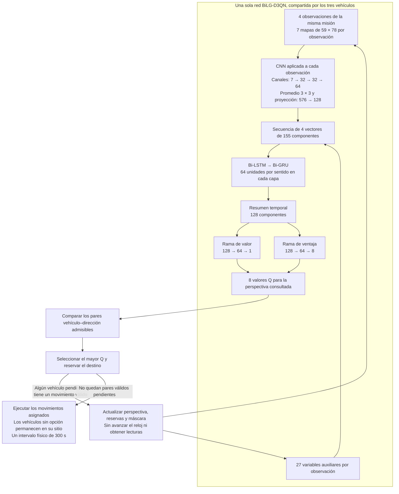
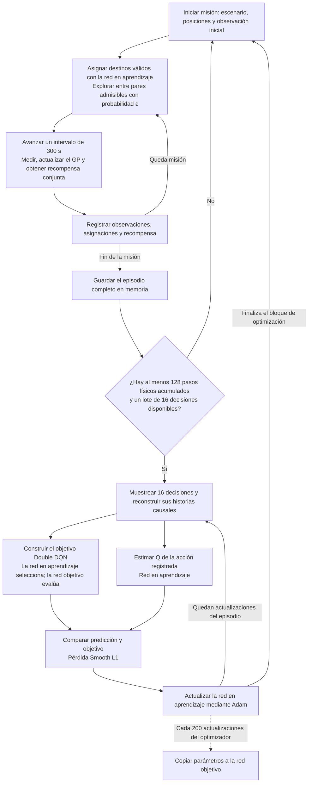

# Diagramas editables de O3

Fuentes Mermaid para las figuras de R3.2. Los gráficos numéricos de entrenamiento
y validación se generan por separado con `lima-pm25-rl informe`.

## Figura 25. Selección centralizada de movimientos de la flota

La historia se amplía una vez por intervalo físico, no al reservar un destino.
La red puede consultar el mismo historial desde otra perspectiva; las nuevas
reservas y la máscara se aplican a la decisión actual.
La selección del mayor Q representa la explotación; durante el entrenamiento
también se seleccionan pares válidos al azar con probabilidad ε.

## Figura 26. Flujo de interacción con el entorno y actualización del agente BiLG-D3QN

Se optimiza después de incorporar el episodio, si se cumplen el mínimo de
experiencia y el tamaño de lote. En las asignaciones intermedias se usa
recompensa cero y descuento unitario. La última asignación aprendible del
intervalo recibe la recompensa conjunta; no se añade un valor futuro al término
de la misión.
